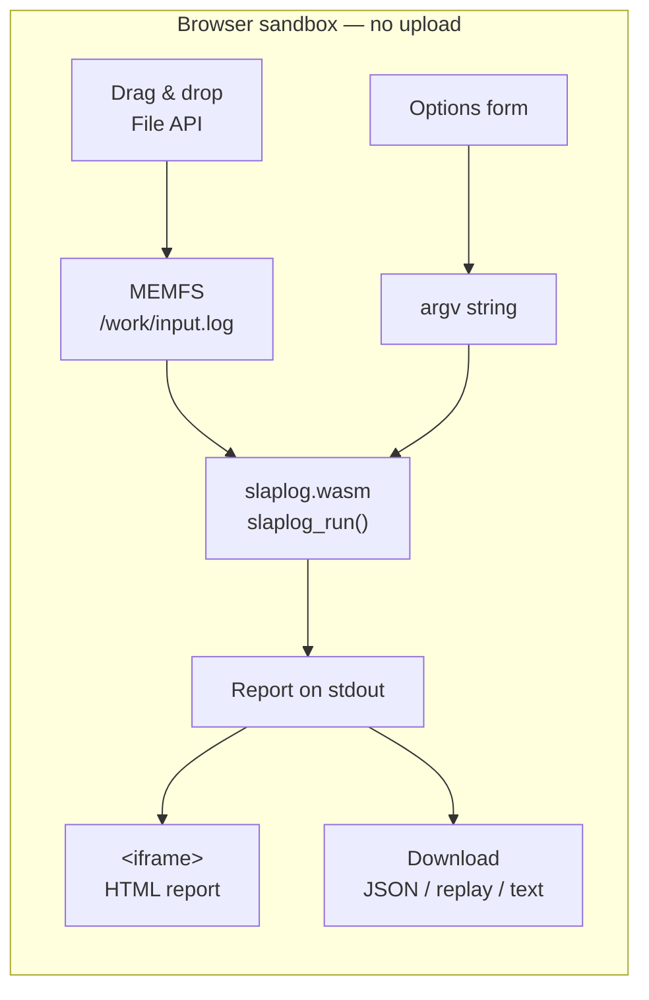
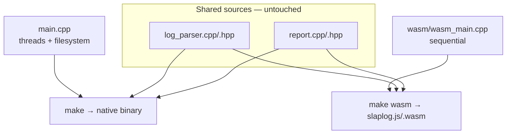

# slaplog — WebAssembly build

Run **slaplog** entirely inside the browser. Drag an OpenLDAP `slapd` access
log onto the page and the report is produced locally by a WebAssembly module —
**the file never leaves your machine**.

**Live build:** <https://slaplog.pages.dev/>



## Prerequisites

- The [Emscripten SDK](https://emscripten.org/) activated (`em++` on `PATH`).
- `nlohmann/json` headers on the host (any of `/usr/include/nlohmann`,
  `/usr/local/include/nlohmann`, `~/.local/include/nlohmann`, or the
  Homebrew prefix). They are staged automatically by `make wasm`.
- Nothing else: **zlib** and **bzip2** come from Emscripten's own ports, and
  **liblzma** (xz) is cross-built once by `wasm/build_liblzma.sh`.

## Build

```bash
make wasm          # -> wasm/web/slaplog.js + wasm/web/slaplog.wasm
```

The first run also cross-builds `liblzma` for wasm32 (a few minutes). The
result is cached in `wasm/prebuilt/`; force a rebuild with
`FORCE=1 wasm/build_liblzma.sh`.

## Run

Serve the `wasm/web/` directory over HTTP (a `file://` page cannot load a
`.wasm` module in most browsers):

```bash
python3 -m http.server -d wasm/web 8000
# open http://localhost:8000/
```

Drop one or more log files, pick the output format and options, then click
**Analyze locally**. Everything runs in the tab; several files are analysed
sequentially and aggregated into a single report, and a progress bar reports
the file in flight and the bytes consumed.

The form mirrors the CLI options. Two details worth knowing:

- The **Replay options** (separator, op limit) appear only when the output
  format is `replay`.
- The **Sections & detail** panel only appears for the `text` format — the
  `html`, `json` and `replay` reports always contain every section. `all` is
  mutually exclusive with the individual sections.
- The input log format is always auto-detected, line by line.

## Deploy

`wasm/deploy.sh` rebuilds and publishes the page in a single command:

```bash
./wasm/deploy.sh                  # make wasm + wrangler pages deploy
SKIP_BUILD=1 ./wasm/deploy.sh     # publish the artefacts already built
PROJECT=other ./wasm/deploy.sh    # target another Cloudflare Pages project
BRANCH=preview ./wasm/deploy.sh   # deploy a preview branch
```

It requires a logged-in `wrangler` (`npx wrangler login`) with access to the
Pages project. Creating the project is a one-off step that must use the legacy
flow — `npx wrangler pages project create <name> --production-branch main
--force`; without `--force` the command is delegated to Cloudflare Workers and
fails. The script itself never needs `--force`.

## How it is wired

| Piece | Role |
|-------|------|
| `wasm_main.cpp` | WASM entry point. Same option names as the CLI, sequential processing, no threads, no `/proc/meminfo`. Exposes a one-shot `slaplog_run()` plus a **session API** (`slaplog_begin` / `slaplog_input_begin` / `slaplog_add_text` / `slaplog_add_file` / `slaplog_input_end` / `slaplog_end`) that lets the page add one file at a time, report progress between files, and still aggregate everything into one report. |
| `web/index.html` | Drag & drop page + options form + progress bar. Writes plain logs into the WASM heap in line-aligned chunks (so the bar advances) and compressed logs into MEMFS, then captures the report from stdout. |
| `build_liblzma.sh` | One-off cross-build of xz/liblzma for wasm32. |
| `../log_parser.cpp`, `../report.cpp` | Compiled **unmodified** by both the native and the WASM build. |

`../main.cpp` is **not** compiled for WASM and is not modified: it depends on
`std::thread` and Linux-only `/proc/meminfo`, neither of which suits a browser.



## Equivalence with the native build

The native and WASM builds now produce **byte-identical** reports for the same
input. Sources of divergence that were fixed:

- **Per-file aggregation.** Each input file is parsed into its own `Aggregator`
  which is then merged with `merge_aggregators()` — exactly what the native
  build does, where every worker owns a local `Aggregator`. Sharing one
  `Aggregator` across files would leak per-connection state (bound DN, open
  connection count) from one file into the next and would round the
  floating-point sums differently. For several files the WASM output matches
  the native binary exactly (`-j 1` or the default pool alike — both were
  measured to be reproducible).

- **Timestamp resolution.** Timestamps are held in `SystemTimePoint`
  (`time_point<system_clock, nanoseconds>`) instead of the platform's
  `system_clock::duration`, which is nanoseconds under libstdc++ but
  microseconds under libc++. `debug`-format timestamps therefore keep their
  sub-microsecond fraction on every toolchain.
- **Ordering of equal-timing rows.** Every ordering path now uses a **total**
  comparator instead of relying on an unstable sort:
  - the replay report breaks timestamp/conn/op ties by input order (the order
    operations appear in the log);
  - the top-N tables (`top_op_before` / `top_conn_before` in `log_parser.hpp`)
    break etime ties by connection, operation, then the remaining fields.

  Previously those ties were left to `std::sort`/`std::partial_sort`, whose
  result for equal elements is implementation-defined and *differs between
  libstdc++ and libc++* — so the same log could render in a different order,
  and even a different set of rows could survive the top-100 cut.

## Limitations

- The module is wasm32: the whole log (plus the aggregator) must fit in the
  tab's memory (a few GB at most). For multi-gigabyte archives prefer the
  native binary.
